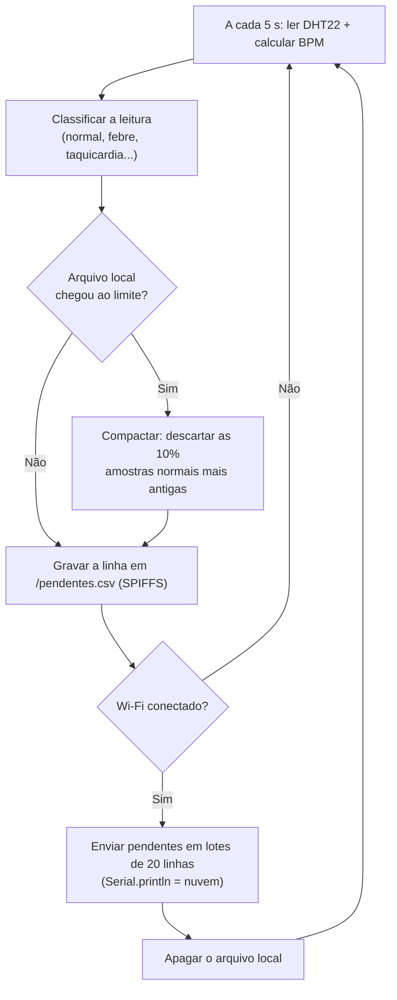

# FIAP - Faculdade de Informática e Administração Paulista

<p align="center">
<a href= "https://www.fiap.com.br/"></a>
</p>

<br>

# CardioIA, Fase 3, Parte 1: armazenamento e processamento local (Edge Computing)

Simulação no Wokwi: https://wokwi.com/projects/479420907001327617


## Descrição

Esta parte simula um monitor cardíaco vestível com ESP32 no Wokwi. A cada 5 segundos o ESP32 lê
a temperatura, a umidade e os batimentos do paciente, classifica a leitura como normal ou de
alerta e grava tudo na memória do próprio dispositivo. O envio para a nuvem só acontece quando
há conexão. Se o Wi-Fi cair, a coleta continua, e as leituras guardadas são enviadas quando ele
voltar.

Esse é o papel do Edge Computing no projeto: o processamento fica perto do paciente. Num monitor
de saúde, a coleta não pode parar porque a internet da casa caiu.

| Sensor | O que mede | Por que usamos |
|---|---|---|
| DHT22 (obrigatório) | Temperatura e umidade | Febre e hipotermia são sinais de alerta em pacientes cardíacos. |
| Botão de pressão | Batimentos por minuto (BPM) | Cada aperto simula um batimento. O BPM é a média dos últimos 5 intervalos entre apertos. |


## Circuito

| Componente | Pino do ESP32 | Função |
|---|:---:|---|
| DHT22 (SDA) | GPIO 15 | Temperatura e umidade |
| Botão "Batimento" | GPIO 4 | Simula o pulso (interrupção na borda de descida) |
| Chave deslizante "Wi-Fi" | GPIO 27 | Liga e desliga a conexão simulada |
| LED verde + resistor 220 Ω | GPIO 25 | Aceso quando há conexão |
| LED vermelho + resistor 220 Ω | GPIO 26 | Aceso quando a última leitura tem alerta clínico |


## Fluxo de funcionamento



A cada 5 segundos o ESP32 lê o DHT22 e calcula o BPM a partir dos apertos do botão. A leitura
recebe um status (`NORMAL`, `FEBRE`, `TAQUICARDIA`, `SEM_PULSO` etc.) e, se for um alerta
clínico, o LED vermelho acende na hora, sem esperar a nuvem.

Toda leitura é gravada primeiro no SPIFFS, no arquivo `/pendentes.csv`, e só depois pode ser
enviada. A chave deslizante do circuito controla a variável booleana `wifiConectado`. Quando ela
fica `true`, o arquivo é enviado linha a linha com `Serial.println` (prefixo `[NUVEM]`) e apagado
no final.

Cada linha do CSV segue este formato:

```
seq,tempo_s,temp_c,umid_pct,bpm,status
42,215,38.4,55.0,128,FEBRE|TAQUICARDIA
```

### Regras de alerta

| Status | Condição |
|---|---|
| `FEBRE` | temperatura ≥ 38,0 °C |
| `HIPOTERMIA` | temperatura < 35,0 °C |
| `TAQUICARDIA` | BPM > 120 |
| `BRADICARDIA` | BPM entre 1 e 49 |
| `SEM_PULSO` | já houve batimentos, mas nenhum nos últimos 10 s (sensor solto ou emergência) |
| `FALHA_DHT` | o DHT22 não respondeu e o último valor válido foi mantido (falha técnica, não acende o LED) |

Uma leitura pode ter mais de um status ao mesmo tempo, separados por `|`.


## Lógica de resiliência offline

Nenhuma leitura é enviada sem antes estar gravada. Se a conexão cair no meio de um envio, a
leitura continua no arquivo local, e a coleta nunca espera pela rede.

O envio é feito em lotes para não travar a coleta. Com 12 horas de dados acumulados, mandar tudo
de uma vez deixaria o ESP32 parado por dezenas de segundos, e batimentos seriam perdidos. Ao
conectar, o programa renomeia `/pendentes.csv` para `/enviando.csv` e passa a gravar as leituras
novas num `/pendentes.csv` novo. A cada volta do `loop()` saem no máximo 20 linhas, e o
`/enviando.csv` é apagado quando o envio termina.

Se a conexão cair no meio do envio, o programa guarda a posição em que parou no arquivo. Quando a
conexão volta, ele continua dali, sem reenviar o que já foi.

Num ESP32 real, o SPIFFS sobrevive a uma queda de energia. Ao ligar, o programa reconta as linhas
dos arquivos que sobraram, continua a numeração (`seq`) de onde parou e retoma os envios
interrompidos. Se a energia cair no meio de uma compactação, o arquivo temporário é restaurado.
Um envio interrompido por reinício recomeça do início do lote, então a nuvem pode receber linhas
repetidas; o campo `seq` serve para descartá-las.

Se o SPIFFS não puder ser montado, o programa guarda as leituras numa fila circular em RAM com
600 amostras (50 minutos), e o Monitor Serial continua registrando tudo, como o enunciado sugere.


## Estratégia de armazenamento limitado

Pensamos num paciente cardiológico monitorado em casa por um vestível. A conexão pode cair durante
a noite (roteador desligado, celular sem bateria, viagem), então escolhemos guardar uma noite
inteira sem conexão.

| Parâmetro | Valor |
|---|---|
| Frequência de leitura | 1 a cada 5 s (720 por hora) |
| Autonomia offline | 12 horas |
| Capacidade | 8.640 amostras |
| Tamanho estimado | cerca de 33 bytes por linha, 285 KB no total |
| Partição SPIFFS | 1,3 MB (tabela padrão do Arduino ESP32, em `partitions.csv`) |

A partição tem espaço para o arquivo cheio e para a cópia temporária usada na compactação.

Quando o limite é atingido, o programa compacta o arquivo: descarta as 864 amostras normais mais
antigas (10%) e mantém as leituras com alerta. Num registro de 12 horas, um trecho antigo de
sinais normais vale pouco para o médico, mas um episódio de taquicardia ou febre continua
importante mesmo horas depois. Alertas só são descartados, dos mais antigos para os mais novos,
quando não há amostras normais suficientes para liberar os 10%. A compactação também acontece se
a memória flash passar de 90% de uso.

Descartar em blocos de 10%, e não uma linha por vez, evita reescrever o arquivo a cada leitura
nova, o que desgastaria a memória flash. Na sincronização seguinte, a nuvem recebe um aviso com o
número de amostras descartadas.


## Como executar e testar

1. Abra o link do Wokwi e inicie a simulação no botão verde.
2. Espere a mensagem `[ARMAZ] SPIFFS montado`. O SPIFFS é formatado do zero a cada início de
   simulação, e o simulador fica lento nesse trecho por cerca de 1 minuto. A mensagem
   `SPIFFS: mount failed` que aparece antes é normal: indica que a partição ainda está vazia.
3. Com a chave Wi-Fi para a esquerda (LED verde apagado), as leituras aparecem como `OFFLINE` e o
   contador `pendentes` aumenta.
4. Clique no botão vermelho no ritmo que quiser. Cerca de 1 clique por segundo dá uns 60 bpm, e
   mais de 2 cliques por segundo gera `TAQUICARDIA`. Se parar de clicar por 10 segundos, aparece
   `SEM_PULSO`.
5. Clique no DHT22 e suba a temperatura para 38 °C ou mais. O LED vermelho acende.
6. Mova a chave para a direita. O LED verde acende, as leituras guardadas saem com o prefixo
   `[NUVEM]` e aparece `[SYNC] Concluído ... Arquivo local apagado.`
7. Para testar uma queda no meio do envio, deixe acumular várias amostras, desligue a chave
   durante o envio e ligue de novo. O envio continua de onde parou.

Exemplo de saída no Monitor Serial:

```
[ARMAZ] SPIFFS montado: 0 de 1318001 bytes usados.
[REDE] Wi-Fi DESCONECTADO. Leituras seguem sendo guardadas localmente.
[LEITURA] #1 | 36.5 C | 55.0 % | 0 bpm | NORMAL | OFFLINE | pendentes: 1/8640
[LEITURA] #4 | 36.5 C | 55.0 % | 126 bpm | TAQUICARDIA | OFFLINE | pendentes: 4/8640
[LEITURA] #7 | 36.5 C | 55.0 % | 0 bpm | SEM_PULSO | OFFLINE | pendentes: 7/8640
[LEITURA] #11 | 39.0 C | 55.0 % | 0 bpm | FEBRE|SEM_PULSO | OFFLINE | pendentes: 11/8640
[REDE] Wi-Fi CONECTADO. Pendentes: 12
[NUVEM] seq,tempo_s,temp_c,umid_pct,bpm,status
[NUVEM] 1,18,36.5,55.0,0,NORMAL
[NUVEM] 4,33,36.5,55.0,126,TAQUICARDIA
[NUVEM] 11,68,39.0,55.0,0,FEBRE|SEM_PULSO
[SYNC] Concluído: 12 amostras enviadas. Arquivo local apagado.
```

O trecho acima está resumido. O envio completo tem as 12 linhas.

### Testes realizados

Além do fluxo acima, testamos o limite e a retomada numa versão temporária do código, com
capacidade de 10 amostras, leitura a cada 1 segundo e envio de 1 linha por volta do `loop()`.

No teste de compactação, o arquivo encheu só com leituras `FEBRE`, e o alerta mais antigo foi
descartado. Depois, com leituras `NORMAL` chegando, cada compactação descartou uma amostra normal
e manteve todas as de febre. Na sincronização seguinte, a nuvem recebeu o aviso
`AVISO: 11 amostras foram descartadas por limite de armazenamento`.

No teste de queda, desligamos a conexão depois do envio da primeira de duas linhas. O programa
mostrou `Conexão perdida no meio do envio` e continuou coletando. Ao reconectar, mostrou
`Retomando envio de onde parou`, enviou só a linha que faltava e depois as novas, sem repetir nem
perder nenhuma.

### Arquivos desta pasta

| Arquivo | Conteúdo |
|---|---|
| `sketch.ino` | Código C++ comentado do ESP32 |
| `diagram.json` | Circuito do Wokwi |
| `libraries.txt` | Biblioteca usada: DHT sensor library for ESPx |
| `partitions.csv` | Tabela de partições com a área de SPIFFS |


## Limitações

- No Wokwi, o SPIFFS existe enquanto a simulação roda e é apagado quando ela para. Num ESP32 real
  ele sobrevive a desligamentos, e é aí que a recuperação ao ligar faz diferença.
- Sem relógio de tempo real, o campo `tempo_s` conta os segundos desde que o ESP32 ligou. Em
  produção, o horário viria de um servidor NTP assim que houvesse conexão.
- O botão substitui um sensor de pulso real, como o MAX30102. O cálculo do BPM pela média dos
  intervalos seria o mesmo com o sensor.
- Nesta parte, a nuvem é simulada pelo `Serial.println`. Na Parte 2, esse ponto do código
  (`gerenciarSincronizacao`) passa a publicar via MQTT, e o arquivo local só deve ser apagado
  depois da confirmação do broker.
