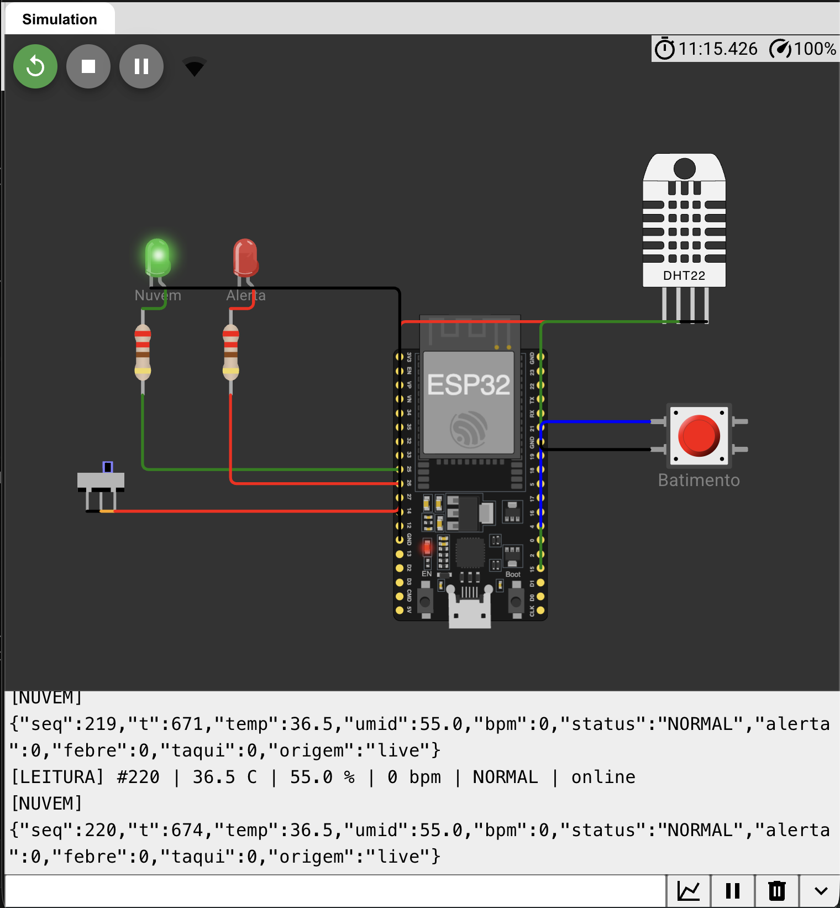
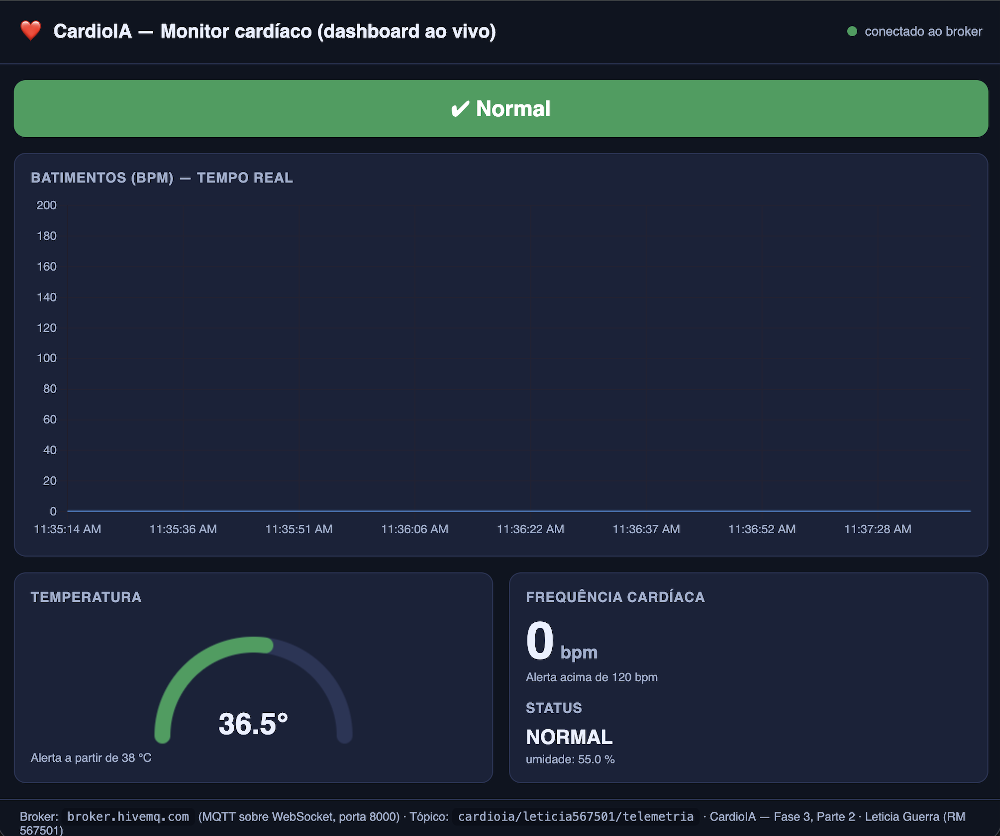
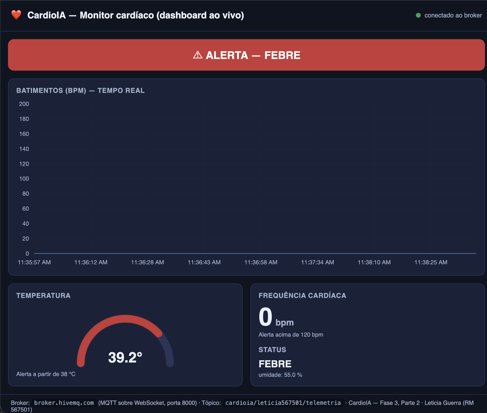
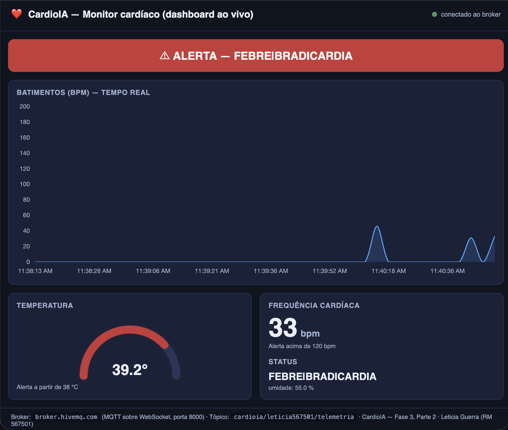

# FIAP - Faculdade de Informática e Administração Paulista

<p align="center">
<a href="https://www.fiap.com.br/"></a>
</p>

<br>

# CardioIA — Fase 3, Parte 2: Transmissão para a Nuvem e Visualização (Fog/Cloud Computing)

**Simulação no Wokwi:** https://wokwi.com/projects/479547665221219329


## 📜 Descrição

Continuação da **Parte 1 (Edge Computing)**. Aqui o monitor cardíaco vestível deixa de apenas
guardar os dados na borda e passa a **publicá-los na nuvem via MQTT** e a **exibi-los em tempo
real** num dashboard, com medidores e **alertas automáticos**.

O ponto onde a Parte 1 enviava para a "nuvem" (`Serial.println`) passa agora a publicar as
leituras num **broker MQTT** (HiveMQ). Um dashboard assina o mesmo tópico e mostra gráfico de
batimentos, medidores (gauges) e um indicador que fica vermelho quando um limite clínico é
ultrapassado. Isso é o **Fog/Cloud Computing**: os dados sobem para a nuvem e viram informação
visível e acionável.

Sensores usados (os mesmos da Parte 1):

| Sensor | O que mede | Por quê |
|---|---|---|
| **DHT22** (obrigatório) | Temperatura e umidade | Febre e hipotermia são sinais de alerta em pacientes cardíacos. |
| **Botão de pressão** | Batimentos cardíacos (BPM) | Cada aperto simula um batimento; o programa calcula o BPM pela média dos últimos intervalos. |


## 🔌 Circuito

O circuito é o mesmo da Parte 1 (arquivo `diagram.json`). A diferença é o papel do LED verde,
que agora indica publicação na nuvem.

| Componente | Pino do ESP32 | Função |
|---|:---:|---|
| DHT22 (SDA) | GPIO 15 | Temperatura e umidade |
| Botão "Batimento" | GPIO 4 | Simula o pulso (interrupção na borda de descida) |
| Chave deslizante "Wi-Fi" | GPIO 27 | Simula a conectividade do paciente (online/offline) |
| LED verde + resistor 220 Ω | GPIO 25 | Aceso = publicando na nuvem (online + MQTT conectado) |
| LED vermelho + resistor 220 Ω | GPIO 26 | Aceso = alerta clínico na última leitura |


## 📡 Comunicação MQTT

| Item | Valor |
|---|---|
| Protocolo | MQTT |
| Broker | `broker.hivemq.com` : `1883` (público) |
| Tópico de telemetria | `cardioia/leticia567501/telemetria` |
| Tópico de alerta | `cardioia/leticia567501/alerta` (mensagem retida) |
| Qualidade de serviço | QoS 0 (telemetria contínua) |

Cada leitura é publicada como um **JSON** de campos simples, fácil de ler em qualquer ferramenta:

```json
{"seq":42,"t":215,"temp":38.4,"umid":55.0,"bpm":128,
 "status":"FEBRE|TAQUICARDIA","alerta":1,"febre":1,"taqui":1,"origem":"live"}
```

O campo `alerta` (0/1) já indica se a leitura é crítica, o que deixa o dashboard simples — ele só
reage a esse campo. O campo `origem` distingue uma leitura enviada ao vivo (`live`) de uma que
estava na fila e foi reenviada depois (`buffer`).


## 📊 Dashboard

A dashboard foi montada no **Node-RED** (paleta `node-red-dashboard`) e está pronta no arquivo
`flows.json` (basta importar). Ela mostra, em tempo real:

- **Gráfico de linha** — batimentos (BPM) ao longo do tempo;
- **Medidor (gauge)** — temperatura (fica vermelho a partir de 38 °C);
- **Medidor (gauge)** — frequência cardíaca (fica vermelho acima de 120 bpm);
- **Indicador de alerta** — faixa que fica **verde (Normal)** ou **vermelha (ALERTA)**, mostrando qual é o alerta.

**Limites de alerta** (os mesmos definidos pelo grupo na Parte 1): temperatura ≥ 38 °C (febre) ou
BPM > 120 (taquicardia). Quando a leitura cruza qualquer um deles, a faixa fica vermelha, os
medidores entram na zona vermelha e o LED vermelho do ESP32 acende — tudo ao mesmo tempo.

Como opcional, o enunciado sugere o **Grafana Cloud** para visualização avançada; o passo a passo
está no `GUIA-EXECUCAO.md`.


## 🖼️ Evidências

Dados reais publicados pelo ESP32 e recebidos no dashboard:

**1. ESP32 publicando no MQTT (Monitor Serial do Wokwi):**



**2. Dashboard em estado normal:**



**3. Alerta automático de febre (temperatura ≥ 38 °C):**



**4. Gráfico de BPM em tempo real e alerta combinado:**




## 🛡️ Resiliência offline

A chave deslizante simula a conectividade do paciente. Nenhuma leitura é perdida quando a conexão
cai:

- **Online:** cada leitura é publicada na hora e o LED verde fica aceso.
- **Offline:** as leituras entram numa **fila em memória** (store-and-forward, o mesmo padrão da
  Parte 1). O dispositivo continua lendo e classificando normalmente.
- **Reconectou:** a fila é esvaziada primeiro — as pendentes são reenviadas (marcadas com
  `origem: buffer`) — e só então o fluxo ao vivo continua.

A fila é curta de propósito (300 leituras ≈ 15 min): a Parte 1 já cobre o armazenamento longo
(12 h em SPIFFS); aqui a fila cobre as quedas rápidas de rede.


## 🔧 Como executar e testar

1. Abra o link do Wokwi acima e clique em ▶️. Aguarde o Wi-Fi e o MQTT conectarem no Monitor Serial.
2. **Ligue a conectividade:** deslize a chave "Wi-Fi" — o LED verde acende e aparecem as linhas
   `[NUVEM] {...}` (dados indo para a nuvem).
3. **Batimentos:** clique no botão "Batimento" no ritmo desejado (~1/s ≈ 60 bpm; mais de 2/s gera
   taquicardia).
4. **Febre:** clique no DHT22 e suba a temperatura para 38 °C ou mais — o LED vermelho acende e o
   dashboard entra em alerta.
5. Para ver o dashboard e gerar os prints, siga o **`GUIA-EXECUCAO.md`** (Node-RED, a página
   `dashboard-web/` sem instalar nada, e o Grafana).


## 📂 Arquivos desta pasta

| Arquivo | Conteúdo |
|---|---|
| `sketch.ino` | Código C++ comentado do ESP32 (publicação via MQTT) |
| `diagram.json` | Circuito do Wokwi (mesmo da Parte 1) |
| `libraries.txt` | Bibliotecas: *DHT sensor library for ESPx* e *PubSubClient* |
| `flows.json` | Export do dashboard do Node-RED (importável) |
| `GUIA-EXECUCAO.md` | Passo a passo para rodar tudo e tirar os prints (inclui Grafana) |
| `dashboard-web/` | Visualizador leve (HTML) usado para gerar os prints, sem instalar nada |
| `prints/` | Evidências do dashboard funcionando |


## ⚠️ Limitações

- **Broker público:** `broker.hivemq.com` é aberto; em produção usar-se-ia usuário, senha e TLS
  (porta 8883) e um tópico imprevisível.
- **Wi-Fi do simulador:** no Wokwi a internet vem da rede `Wokwi-GUEST`; num ESP32 real entraria o
  Wi-Fi da casa do paciente.
- **Batimento simulado:** o botão substitui um sensor de pulso real (como o MAX30102); a lógica de
  média dos intervalos é a mesma.
- **Horário:** sem relógio de tempo real, o campo `t` conta os segundos desde que o dispositivo
  ligou; em produção o horário viria de um servidor NTP.
