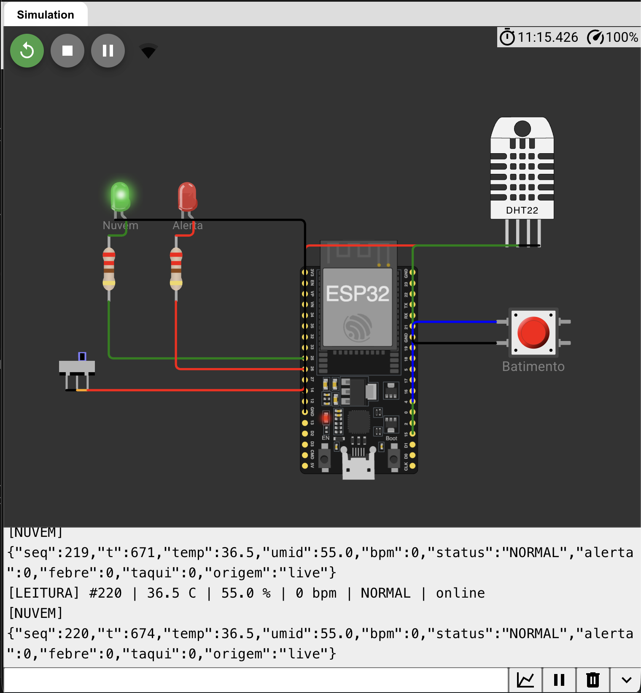
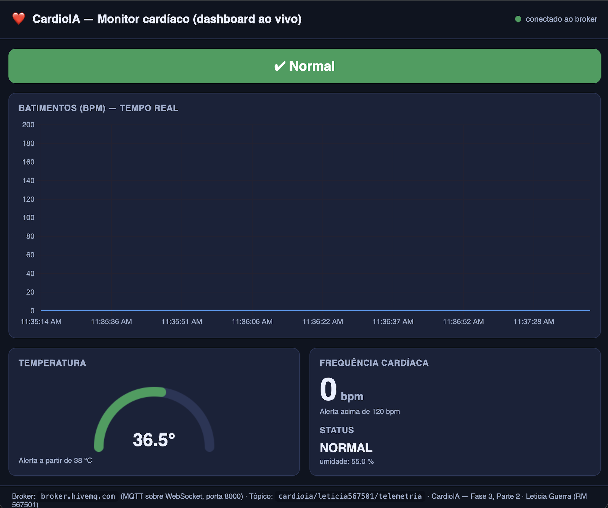
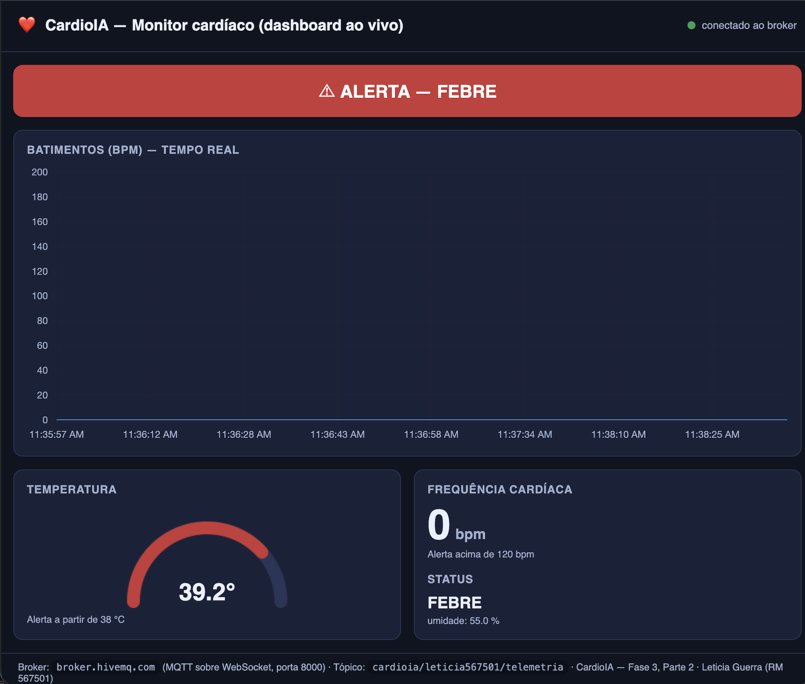
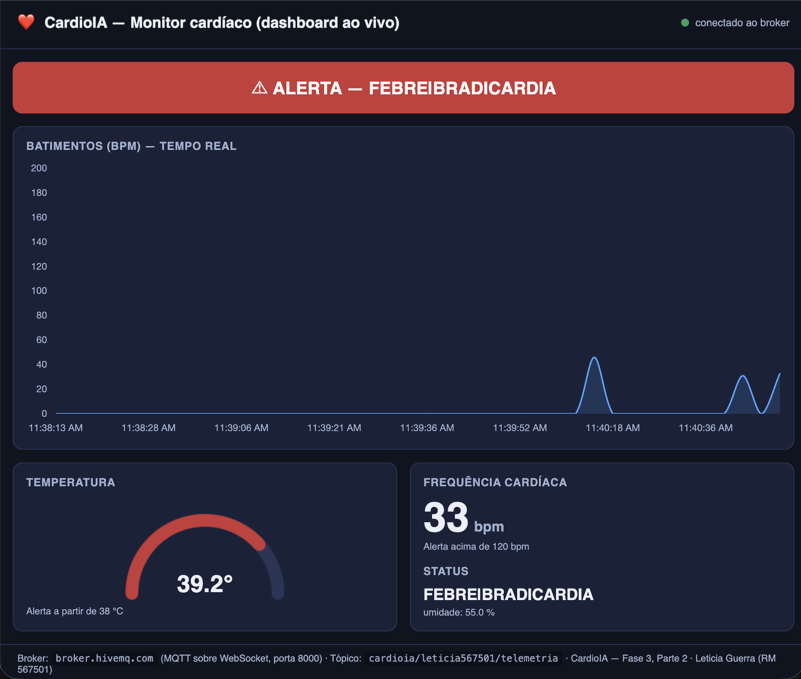

# FIAP - Faculdade de Informática e Administração Paulista

 

# CardioIA — Fase 3: Monitoramento Contínuo (IoT na Saúde)

Projeto acadêmico do curso de IA da FIAP. Nesta fase construímos um protótipo de **monitor cardíaco vestível** com ESP32, cobrindo o ciclo completo de IoT em saúde digital: **captura → processamento → transmissão → visualização → alerta**, integrando Edge, Fog e Cloud Computing.

## Equipe

Trabalho desenvolvido em grupo. Integrantes:

- João Rafael Gonçalves Ramos — RM: 567908
- Letícia Angelim Guerra — RM: 567501
- Matheus Guimarães França — RM: 567144
- Rivando Bezerra Cavalcanti Neto — RM: 568235

## Visão geral

O mesmo dispositivo e circuito atravessam as duas partes. Os sensores são um **DHT22** (temperatura e umidade) e um **botão** que simula os batimentos cardíacos (BPM), com LEDs de status e uma chave deslizante que simula a conectividade.

- **Parte 1 — Edge Computing:** o ESP32 lê os sensores, classifica cada leitura na borda (normal, febre, taquicardia…) e **guarda tudo localmente** (SPIFFS), com resiliência offline e política de armazenamento limitado. Quando há conexão, sincroniza os dados pendentes.
- **Parte 2 — Fog/Cloud Computing:** o ponto em que a Parte 1 enviava para a "nuvem" passa a **publicar via MQTT** (broker HiveMQ). Um **dashboard em tempo real** mostra gráfico de BPM, medidores (gauges) e **alertas automáticos** quando os limites são ultrapassados, além de visualização avançada no Grafana e a mesma lógica de resiliência.

## Links das simulações (Wokwi)

- **Parte 1 (Edge):** https://wokwi.com/projects/479420907001327617
- **Parte 2 (Fog/Cloud):** https://wokwi.com/projects/479547665221219329

## Estrutura da pasta FASE-3

| Caminho | Conteúdo |
|---|---|
| `README.md` | Este arquivo — relatório único da Fase 3 (Parte 1 + Parte 2) |
| `Parte-1/` | Código e arquivos da Parte 1 (Edge Computing) |
| `Parte-2/` | Código, dashboard e evidências da Parte 2 (Fog/Cloud) |
| `Parte-2/flows.json` | Dashboard do Node-RED (importável) |
| `Parte-2/dashboard-web/` | Visualizador leve usado para gerar os prints |
| `Parte-2/prints/` | Evidências do dashboard funcionando |

 

---

 

# PARTE 1 — Armazenamento e Processamento Local (Edge Computing)

**Simulação no Wokwi:** https://wokwi.com/projects/479420907001327617

## Descrição

Protótipo de um **monitor cardíaco vestível** com ESP32, simulado no Wokwi. O dispositivo lê sinais vitais do paciente, **decide sozinho** se a leitura é normal ou de alerta e **guarda tudo localmente** antes de enviar para a nuvem. Se a conexão cair, ele continua coletando; quando a conexão volta, envia o que ficou pendente e apaga o arquivo local.

É isso que chamamos de **Edge Computing**: o processamento acontece na borda, perto do paciente. Numa aplicação de saúde isso é crítico, porque a coleta não pode parar só porque o Wi-Fi da casa do paciente caiu.

Sensores usados:

| Sensor | O que mede | Por quê |
|---|---|---|
| **DHT22** (obrigatório) | Temperatura e umidade | Febre e hipotermia são sinais de alerta em pacientes cardíacos. |
| **Botão de pressão** | Batimentos cardíacos (BPM) | Cada aperto simula um batimento. O programa calcula o BPM pela média dos últimos 5 intervalos entre apertos. |

## Circuito

| Componente | Pino do ESP32 | Função |
|---|:---:|---|
| DHT22 (SDA) | GPIO 15 | Temperatura e umidade |
| Botão "Batimento" | GPIO 4 | Simula o pulso (interrupção na borda de descida) |
| Chave deslizante "Wi-Fi" | GPIO 27 | Liga/desliga a conexão simulada |
| LED verde + resistor 220 Ω | GPIO 25 | Aceso = online |
| LED vermelho + resistor 220 Ω | GPIO 26 | Aceso = alerta clínico na última leitura |

## Fluxo de funcionamento

1. **Coleta:** a cada 5 segundos o ESP32 lê o DHT22 e calcula o BPM a partir dos apertos do botão.
2. **Processamento na borda:** a leitura recebe um status (`NORMAL`, `FEBRE`, `TAQUICARDIA`, `SEM_PULSO`...). O LED vermelho acende na hora, sem depender da nuvem.
3. **Armazenamento local:** **toda** leitura é gravada primeiro no SPIFFS, em `/pendentes.csv`. Só depois ela pode ser enviada (padrão *store-and-forward*, "guarda e depois encaminha").
4. **Conectividade simulada:** a chave deslizante alimenta a variável booleana `wifiConectado`.
5. **Sincronização:** com `wifiConectado = true`, o arquivo é enviado linha a linha com `Serial.println` (prefixo `[NUVEM]`) e, ao final, **apagado**.

Formato de cada linha do CSV:

    seq,tempo_s,temp_c,umid_pct,bpm,status
    42,215,38.4,55.0,128,FEBRE|TAQUICARDIA

### Regras de alerta

| Status | Condição |
|---|---|
| `FEBRE` | temperatura ≥ 38,0 °C |
| `HIPOTERMIA` | temperatura < 35,0 °C |
| `TAQUICARDIA` | BPM > 120 |
| `BRADICARDIA` | BPM entre 1 e 49 |
| `SEM_PULSO` | já houve batimentos, mas nenhum nos últimos 10 s (sensor solto ou emergência) |
| `FALHA_DHT` | o DHT22 não respondeu; o último valor válido é mantido (falha técnica, não acende o LED) |

Uma leitura pode ter mais de um status ao mesmo tempo, separados por `|`.

## Lógica de resiliência offline

**1. Nada é enviado sem antes ser gravado.** Se a conexão cair no meio de um envio, a leitura continua no arquivo local. A coleta nunca depende da rede.

**2. Envio em lotes, sem travar a coleta.** Com 12 h de dados acumulados, enviar tudo de uma vez travaria o ESP32 por dezenas de segundos e batimentos seriam perdidos. Por isso: ao conectar, `/pendentes.csv` é renomeado para `/enviando.csv` ("congela" o lote); as leituras novas continuam indo para um `/pendentes.csv` novo; a cada volta do `loop()` são enviadas no máximo 20 linhas; ao terminar, `/enviando.csv` é apagado.

**3. Queda no meio do envio.** O programa guarda a posição do arquivo onde parou. Quando a conexão volta, retoma exatamente dali, sem reenviar o que já foi.

**4. Queda de energia (ESP32 real).** Ao ligar, o programa reconta as linhas dos arquivos que sobraram no SPIFFS, continua a numeração (`seq`) de onde parou e retoma envios interrompidos. O campo `seq` permite à nuvem descartar eventuais linhas repetidas.

**5. Plano B.** Se o SPIFFS não puder ser montado, o programa usa uma fila circular em RAM com 600 amostras (50 minutos) e o Monitor Serial segue registrando tudo.

## Estratégia de armazenamento limitado

**Cenário de negócio:** paciente cardiológico monitorado em casa por um vestível. A conexão pode cair durante a noite. Escolhemos cobrir uma noite inteira sem conexão.

| Parâmetro | Valor |
|---|---|
| Frequência de leitura | 1 a cada 5 s (720 por hora) |
| Autonomia offline | 12 horas |
| Capacidade | **8.640 amostras** |
| Tamanho estimado | ~33 bytes por linha → ~285 KB |
| Partição SPIFFS | 1,3 MB (tabela padrão do Arduino ESP32) |

**Quando o limite é atingido**, o arquivo é compactado: as **864 amostras NORMAIS mais antigas (10%)** são descartadas e as **leituras com alerta são preservadas** — são as que o médico mais precisa ver. Alertas só são descartados (os mais antigos primeiro) quando não há amostras normais suficientes. Na próxima sincronização, a nuvem recebe um aviso com o número de amostras descartadas.

## Como executar e testar (Parte 1)

1. Abra o link do Wokwi acima e inicie a simulação.
2. **Offline:** com a chave Wi-Fi para a esquerda (LED verde apagado), as leituras aparecem como `OFFLINE` e o contador `pendentes` cresce.
3. **Batimentos:** clique no botão vermelho (~1/s ≈ 60 bpm; mais de 2/s gera `TAQUICARDIA`; parar por 10 s gera `SEM_PULSO`).
4. **Febre:** clique no DHT22 e suba a temperatura para 38 °C ou mais — o LED vermelho acende.
5. **Sincronização:** mova a chave para a direita — o LED verde acende, as leituras saem com `[NUVEM]` e o arquivo local é apagado.

## Limitações (Parte 1)

- **SPIFFS volátil no simulador:** no Wokwi o arquivo some ao parar a simulação; num ESP32 real ele persiste.
- **Horário:** sem relógio de tempo real, `tempo_s` conta os segundos desde que o dispositivo ligou (em produção, viria de um servidor NTP).
- **Batimento simulado:** o botão substitui um sensor de pulso real (como o MAX30102).
- **"Nuvem" simulada:** nesta parte o envio é o `Serial.println`. Na Parte 2 ele passa a publicar via MQTT.

 

---

 

# PARTE 2 — Transmissão para a Nuvem e Visualização (Fog/Cloud Computing)

**Simulação no Wokwi:** https://wokwi.com/projects/479547665221219329

## Descrição

Continuação da Parte 1. Aqui o monitor deixa de apenas guardar os dados na borda e passa a **publicá-los na nuvem via MQTT** e a **exibi-los em tempo real** num dashboard, com medidores e **alertas automáticos**.

O ponto onde a Parte 1 enviava para a "nuvem" (`Serial.println`) passa agora a publicar as leituras num **broker MQTT** (HiveMQ). Um dashboard assina o mesmo tópico e mostra gráfico de batimentos, medidores (gauges) e um indicador que fica vermelho quando um limite clínico é ultrapassado. Isso é o **Fog/Cloud Computing**: os dados sobem para a nuvem e viram informação visível e acionável.

## Comunicação MQTT

| Item | Valor |
|---|---|
| Protocolo | MQTT |
| Broker | `broker.hivemq.com` : `1883` (público) |
| Tópico de telemetria | `cardioia/leticia567501/telemetria` |
| Tópico de alerta | `cardioia/leticia567501/alerta` (mensagem retida) |
| Qualidade de serviço | QoS 0 (telemetria contínua) |

Cada leitura é publicada como um **JSON** de campos simples:

    {"seq":42,"t":215,"temp":38.4,"umid":55.0,"bpm":128,
     "status":"FEBRE|TAQUICARDIA","alerta":1,"febre":1,"taqui":1,"origem":"live"}

O campo `alerta` (0/1) já indica se a leitura é crítica, o que deixa o dashboard simples. O campo `origem` distingue uma leitura enviada ao vivo (`live`) de uma que estava na fila e foi reenviada depois (`buffer`).

## Dashboard

A dashboard foi montada no **Node-RED** (paleta `node-red-dashboard`) e está pronta no arquivo `Parte-2/flows.json` (basta importar). Mostra, em tempo real:

- **Gráfico de linha** — batimentos (BPM) ao longo do tempo;
- **Medidor (gauge)** — temperatura (fica vermelho a partir de 38 °C);
- **Medidor (gauge)** — frequência cardíaca (fica vermelho acima de 120 bpm);
- **Indicador de alerta** — faixa que fica **verde (Normal)** ou **vermelha (ALERTA)**.

**Limites de alerta** (os mesmos da Parte 1): temperatura ≥ 38 °C (febre) ou BPM > 120 (taquicardia). Quando a leitura cruza qualquer um deles, a faixa fica vermelha, os medidores entram na zona vermelha e o LED vermelho do ESP32 acende. Como opcional, o enunciado sugere o **Grafana Cloud** (passo a passo em `Parte-2/GUIA-EXECUCAO.md`).

## Evidências

Dados reais publicados pelo ESP32 e recebidos no dashboard:

**1. ESP32 publicando no MQTT (Monitor Serial do Wokwi):**

**2. Dashboard em estado normal:**

**3. Alerta automático de febre (temperatura ≥ 38 °C):**

**4. Gráfico de BPM em tempo real e alerta combinado:**

## Resiliência offline (Parte 2)

A chave deslizante simula a conectividade do paciente. Nenhuma leitura é perdida quando a conexão cai:

- **Online:** cada leitura é publicada na hora e o LED verde fica aceso.
- **Offline:** as leituras entram numa **fila em memória** (store-and-forward). O dispositivo continua lendo e classificando.
- **Reconectou:** a fila é esvaziada primeiro (as pendentes voltam marcadas com `origem: buffer`) e só então o fluxo ao vivo continua.

A fila é curta de propósito (300 leituras ≈ 15 min): a Parte 1 já cobre o armazenamento longo (12 h em SPIFFS); aqui a fila cobre as quedas rápidas de rede.

## Como executar e testar (Parte 2)

1. Abra o link do Wokwi da Parte 2 e inicie a simulação. Aguarde o Wi-Fi e o MQTT conectarem.
2. **Ligue a conectividade:** deslize a chave "Wi-Fi" — o LED verde acende e aparecem as linhas `[NUVEM] {...}`.
3. **Batimentos:** clique no botão "Batimento" no ritmo desejado.
4. **Febre:** suba a temperatura do DHT22 para 38 °C ou mais — o dashboard entra em alerta.
5. Para ver o dashboard e gerar os prints, siga o `Parte-2/GUIA-EXECUCAO.md` (Node-RED, a página `dashboard-web/` sem instalar nada, e o Grafana).

## Limitações (Parte 2)

- **Broker público:** `broker.hivemq.com` é aberto; em produção usar-se-ia usuário, senha e TLS (porta 8883).
- **Wi-Fi do simulador:** no Wokwi a internet vem da rede `Wokwi-GUEST`.
- **Batimento simulado:** o botão substitui um sensor de pulso real (como o MAX30102).
- **Horário:** sem relógio de tempo real, o campo `t` conta os segundos desde que o dispositivo ligou.
