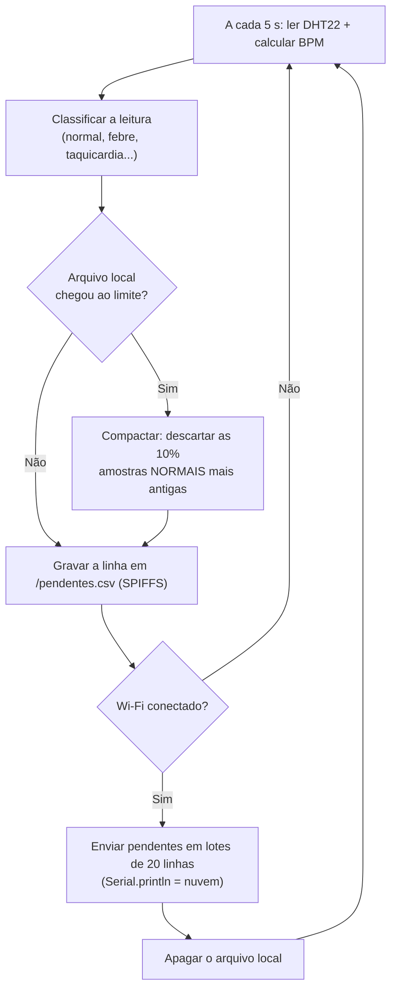

# FIAP - Faculdade de Informática e Administração Paulista

<p align="center">
<a href= "https://www.fiap.com.br/"></a>
</p>

<br>

# CardioIA — Fase 3, Parte 1: Armazenamento e Processamento Local (Edge Computing)

**Simulação no Wokwi:** https://wokwi.com/projects/479420907001327617


## Descrição

Protótipo de um **monitor cardíaco vestível** com ESP32, simulado no Wokwi. O dispositivo lê
sinais vitais do paciente, **decide sozinho** se a leitura é normal ou de alerta e **guarda tudo
localmente** antes de enviar para a nuvem. Se a conexão cair, ele continua coletando; quando a
conexão volta, envia o que ficou pendente e apaga o arquivo local.

É isso que chamamos de **Edge Computing**: o processamento acontece na borda, perto do paciente.
Numa aplicação de saúde isso é crítico, porque a coleta não pode parar só porque o Wi-Fi da casa
do paciente caiu.

Sensores usados:

| Sensor | O que mede | Por quê |
|---|---|---|
| **DHT22** (obrigatório) | Temperatura e umidade | Febre e hipotermia são sinais de alerta em pacientes cardíacos. |
| **Botão de pressão** | Batimentos cardíacos (BPM) | Cada aperto simula um batimento. O programa calcula o BPM pela média dos últimos 5 intervalos entre apertos. |


## Circuito

| Componente | Pino do ESP32 | Função |
|---|:---:|---|
| DHT22 (SDA) | GPIO 15 | Temperatura e umidade |
| Botão "Batimento" | GPIO 4 | Simula o pulso (interrupção na borda de descida) |
| Chave deslizante "Wi-Fi" | GPIO 27 | Liga/desliga a conexão simulada |
| LED verde + resistor 220 Ω | GPIO 25 | Aceso = online |
| LED vermelho + resistor 220 Ω | GPIO 26 | Aceso = alerta clínico na última leitura |


## Fluxo de funcionamento



1. **Coleta:** a cada 5 segundos o ESP32 lê o DHT22 e calcula o BPM a partir dos apertos do botão.
2. **Processamento na borda:** a leitura recebe um status (`NORMAL`, `FEBRE`, `TAQUICARDIA`,
   `SEM_PULSO`...). O LED vermelho acende na hora, sem depender da nuvem.
3. **Armazenamento local:** **toda** leitura é gravada primeiro no SPIFFS, em `/pendentes.csv`.
   Só depois ela pode ser enviada (padrão *store-and-forward*, "guarda e depois encaminha").
4. **Conectividade simulada:** a chave deslizante alimenta a variável booleana `wifiConectado`.
5. **Sincronização:** com `wifiConectado = true`, o arquivo é enviado linha a linha com
   `Serial.println` (prefixo `[NUVEM]`) e, ao final, **apagado**.

Formato de cada linha do CSV:

```
seq,tempo_s,temp_c,umid_pct,bpm,status
42,215,38.4,55.0,128,FEBRE|TAQUICARDIA
```

### Regras de alerta

| Status | Condição |
|---|---|
| `FEBRE` | temperatura ≥ 38,0 °C |
| `HIPOTERMIA` | temperatura < 35,0 °C |
| `TAQUICARDIA` | BPM > 120 |
| `BRADICARDIA` | BPM entre 1 e 49 |
| `SEM_PULSO` | já houve batimentos, mas nenhum nos últimos 10 s (sensor solto ou emergência) |
| `FALHA_DHT` | o DHT22 não respondeu; o último valor válido é mantido (falha técnica, não acende o LED) |

Uma leitura pode ter mais de um status ao mesmo tempo, separados por `|`.


## Lógica de resiliência offline

**1. Nada é enviado sem antes ser gravado.** Se a conexão cair no meio de um envio, a leitura
continua no arquivo local. A coleta nunca depende da rede.

**2. Envio em lotes, sem travar a coleta.** Com 12 h de dados acumulados, enviar tudo de uma vez
travaria o ESP32 por dezenas de segundos e batimentos seriam perdidos. Por isso:

- ao conectar, `/pendentes.csv` é renomeado para `/enviando.csv` ("congela" o lote);
- as leituras novas continuam indo para um `/pendentes.csv` novo;
- a cada volta do `loop()` são enviadas no máximo 20 linhas;
- ao terminar, `/enviando.csv` é apagado.

**3. Queda no meio do envio.** O programa guarda a posição do arquivo onde parou. Quando a
conexão volta, retoma exatamente dali, sem reenviar o que já foi.

**4. Queda de energia (ESP32 real).** Ao ligar, o programa reconta as linhas dos arquivos que sobraram
no SPIFFS, continua a numeração (`seq`) de onde parou e retoma envios interrompidos. Se a energia
cair no meio de uma compactação, o arquivo temporário é restaurado. Como um envio interrompido
por reinício recomeça do início do lote, a nuvem pode receber linhas repetidas; o campo `seq`
permite descartá-las.

**5. Plano B.** Se o SPIFFS não puder ser montado, o programa usa uma fila circular em RAM com
600 amostras (50 minutos) e o Monitor Serial segue registrando tudo, como o enunciado sugere.


## Estratégia de armazenamento limitado

**Cenário de negócio:** paciente cardiológico monitorado em casa por um vestível. A conexão pode
cair durante a noite (roteador desligado, celular sem bateria, viagem). Escolhemos cobrir uma
noite inteira sem conexão.

| Parâmetro | Valor |
|---|---|
| Frequência de leitura | 1 a cada 5 s (720 por hora) |
| Autonomia offline | 12 horas |
| Capacidade | **8.640 amostras** |
| Tamanho estimado | ~33 bytes por linha → ~285 KB |
| Partição SPIFFS | 1,3 MB (tabela padrão do Arduino ESP32, em `partitions.csv`) |

O espaço da partição comporta o arquivo cheio **e** a cópia temporária usada na compactação.

**Quando o limite é atingido**, o arquivo é compactado: as **864 amostras NORMAIS mais antigas
(10%)** são descartadas e as **leituras com alerta são preservadas**. Num quadro de 12 horas, um
trecho antigo de sinais normais vale pouco para o médico; um episódio de taquicardia ou de febre,
mesmo antigo, é exatamente o que ele precisa ver. Alertas só são descartados (os mais antigos
primeiro) quando não há amostras normais suficientes para liberar os 10%. A compactação também
é disparada se a memória flash passar de 90% de uso.

Descartar em blocos de 10% (e não uma linha por vez) evita reescrever o arquivo a cada nova
leitura, o que gastaria a memória flash. Na próxima sincronização, a nuvem recebe um aviso com o
número de amostras descartadas.


## Como executar e testar

1. Abra o link do Wokwi acima e clique no botão verde para iniciar a simulação.
2. Aguarde a mensagem `[ARMAZ] SPIFFS montado`. A cada início de simulação o SPIFFS é formatado
   do zero, e o simulador fica lento nesse trecho (cerca de 1 minuto). A mensagem
   `SPIFFS: mount failed` antes dela é normal: é o aviso de que a partição ainda está vazia.
3. **Offline:** com a chave Wi-Fi para a esquerda (LED verde apagado), as leituras aparecem como
   `OFFLINE` e o contador `pendentes` cresce.
4. **Batimentos:** clique no botão vermelho no ritmo desejado. Cerca de 1 clique por segundo dá
   ~60 bpm; mais de 2 cliques por segundo gera `TAQUICARDIA`. Parar de clicar por 10 s gera
   `SEM_PULSO`.
5. **Febre:** clique no DHT22 e suba a temperatura para 38 °C ou mais. O LED vermelho acende.
6. **Sincronização:** mova a chave para a direita. O LED verde acende, as leituras guardadas
   saem com o prefixo `[NUVEM]` e aparece `[SYNC] Concluído ... Arquivo local apagado.`
7. **Queda no meio do envio:** com muitas amostras pendentes, desligue a chave durante o envio
   e ligue de novo. O envio é retomado de onde parou.

Exemplo de saída no Monitor Serial:

```
[ARMAZ] SPIFFS montado: 0 de 1318001 bytes usados.
[REDE] Wi-Fi DESCONECTADO. Leituras seguem sendo guardadas localmente.
[LEITURA] #1 | 36.5 C | 55.0 % | 0 bpm | NORMAL | OFFLINE | pendentes: 1/8640
[LEITURA] #4 | 36.5 C | 55.0 % | 126 bpm | TAQUICARDIA | OFFLINE | pendentes: 4/8640
[LEITURA] #7 | 36.5 C | 55.0 % | 0 bpm | SEM_PULSO | OFFLINE | pendentes: 7/8640
[LEITURA] #11 | 39.0 C | 55.0 % | 0 bpm | FEBRE|SEM_PULSO | OFFLINE | pendentes: 11/8640
[REDE] Wi-Fi CONECTADO. Pendentes: 12
[NUVEM] seq,tempo_s,temp_c,umid_pct,bpm,status
[NUVEM] 1,18,36.5,55.0,0,NORMAL
[NUVEM] 4,33,36.5,55.0,126,TAQUICARDIA
[NUVEM] 11,68,39.0,55.0,0,FEBRE|SEM_PULSO
[SYNC] Concluído: 12 amostras enviadas. Arquivo local apagado.
```

*(trecho resumido; o envio inclui todas as 12 linhas)*

### Testes realizados

Além do fluxo acima, a lógica de limite e de retomada foi testada numa versão temporária com
capacidade de 10 amostras, leitura a cada 1 s e envio de 1 linha por volta:

- **Compactação:** com o arquivo cheio de leituras `FEBRE` seguidas de leituras `NORMAL`, cada
  compactação descartou uma amostra **normal** e manteve todas as de febre. Quando só havia
  alertas, o alerta mais antigo foi descartado. Na sincronização seguinte a nuvem recebeu o aviso
  `AVISO: 11 amostras foram descartadas por limite de armazenamento`.
- **Queda no meio do envio:** a conexão foi desligada depois do envio da primeira de duas linhas. O programa
  avisou `Conexão perdida no meio do envio`, continuou coletando e, ao reconectar, imprimiu
  `Retomando envio de onde parou`, enviou só a linha que faltava e depois as novas. Nenhuma
  linha foi repetida ou perdida.

### Arquivos desta pasta

| Arquivo | Conteúdo |
|---|---|
| `sketch.ino` | Código C++ comentado do ESP32 |
| `diagram.json` | Circuito do Wokwi |
| `libraries.txt` | Biblioteca usada: *DHT sensor library for ESPx* |
| `partitions.csv` | Tabela de partições com a área de SPIFFS |


## Limitações

- **SPIFFS volátil no simulador:** no Wokwi o arquivo existe enquanto a simulação roda e é
  apagado ao pará-la. Em um ESP32 real ele sobrevive a desligamentos, e é aí que a recuperação
  ao ligar (item 4 da resiliência) faz diferença.
- **Horário:** sem relógio de tempo real, `tempo_s` conta os segundos desde que o dispositivo
  ligou. Em produção, o horário viria de um servidor NTP assim que houvesse conexão.
- **Batimento simulado:** o botão substitui um sensor de pulso real (como o MAX30102). A lógica de
  média dos intervalos é a mesma que seria usada com o sensor.
- **"Nuvem" simulada:** nesta parte o envio é o `Serial.println`. Na Parte 2, a linha marcada no
  código (`gerenciarSincronizacao`) passa a publicar via MQTT, e o arquivo só deve ser apagado
  depois da confirmação do broker.
